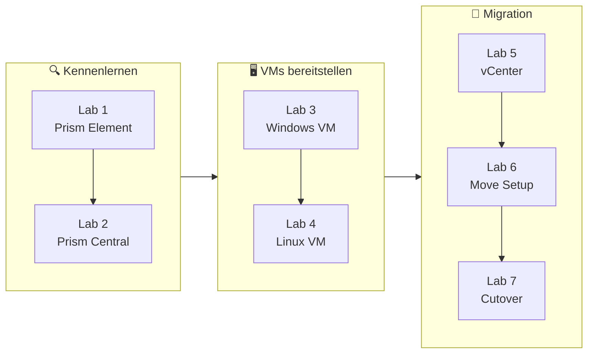
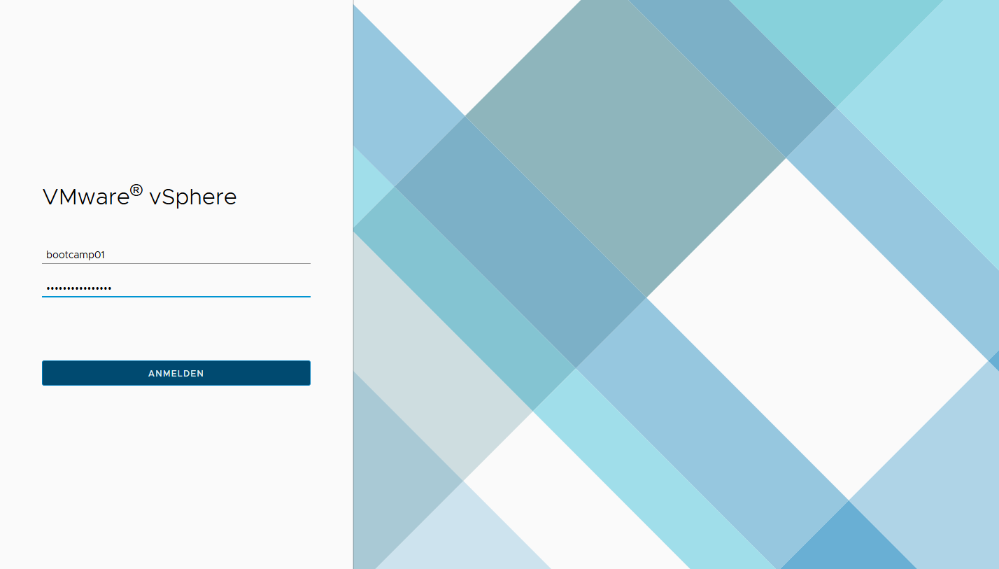

<div align="center">

# 🚀 Nutanix Bootcamp

**Hands-on Labs rund um Nutanix AHV, Prism und die Migration von VMware mit Nutanix Move**


</div>

---

## 🗺️ Ablauf



---

## 📚 Labs

| | Lab | Inhalt | Schritte |
|:-:|---|---|:-:|
|  | **[Lab 1 – Prism Element erkunden](labs/Lab1_Prism_Element.md)** | Login am Cluster, Hardware-, Storage- und Netzwerk-Diagramme, Health-Übersicht | 7 |
|  | **[Lab 2 – Prism Central](labs/Lab2_Prism_Central.md)** | Dashboard, VMs, Images, Storage Container, Netzwerke, Security, Protection Policies, IAM | 14 |
|  | **[Lab 3 – Windows VM Bereitstellung](labs/Lab3_Windows_VM.md)** | Deployment aus einem Template mit Sysprep-Gastanpassung | 5 |
|  | **[Lab 4 – Linux VM Bereitstellung](labs/Lab4_Linux_VM.md)** | RHEL 10 aus einem Template mit cloud-init, optional SSH-Login | 8 |
|  | **[Lab 5 – vCenter erkunden](labs/Lab5_vCenter.md)** | Bestehende vSphere-Umgebung ansehen, eigene VMs und IP-Adressen notieren | 1 |
|  | **[Lab 6 – Nutanix Move: Initiales Setup](labs/Lab6_Nutanix_Move_Setup.md)** | Migration Plan anlegen: Source/Target, VM-Auswahl, Netzwerk-Mapping, VM-Vorbereitung | 19 |
|  | **[Lab 7 – Nutanix Move: Cutover](labs/Lab7_Nutanix_Move_Cutover.md)** | Fortschritt der Replikation verfolgen, Cutover auslösen, Ergebnis in Prism Central prüfen | 4 |

---

## ✅ Bevor du startest

> [!NOTE]
> Zugangsdaten (Prism, vCenter, Nutanix Move sowie Benutzer/Passwort der VMs) und deine **zweistellige Bootcamp-Nummer** bekommst du vom Vortragenden.

> [!TIP]
> Arbeite die Labs der Reihe nach durch – Lab 6 und 7 bauen auf den VMs aus Lab 5 auf.

---

## 📁 Aufbau des Repositories

```text
NutanixBootcamp/
├── README.md              ← diese Übersicht
└── labs/
    ├── Lab1_Prism_Element.md
    ├── Lab2_Prism_Central.md
    ├── ...
    └── images/            ← Screenshots je Lab
```
