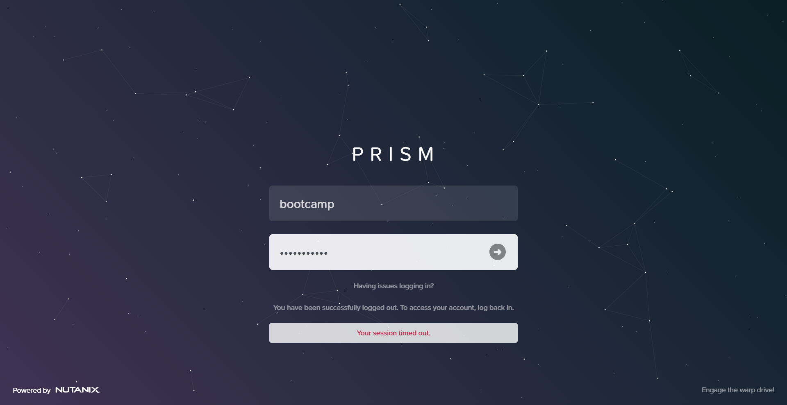
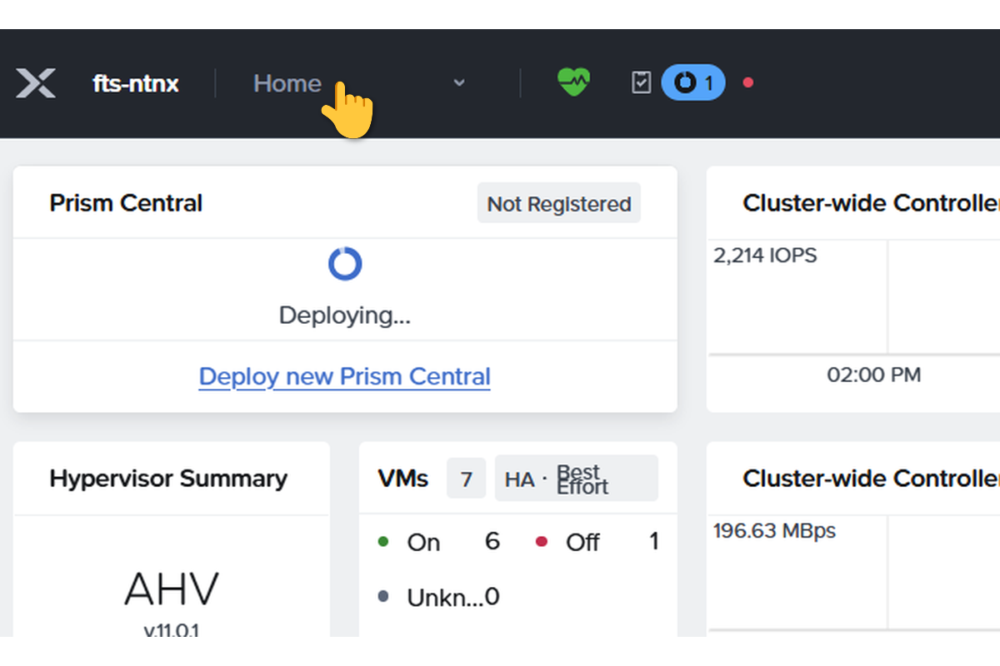
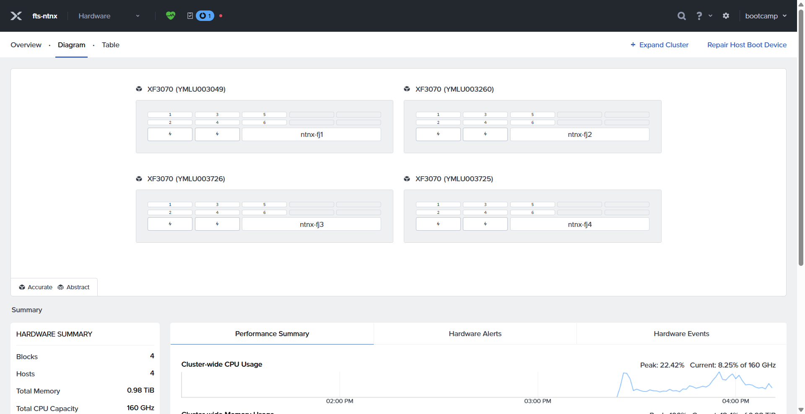
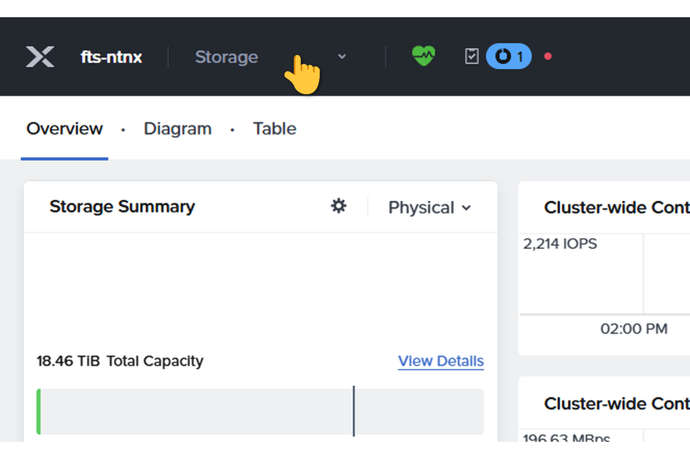
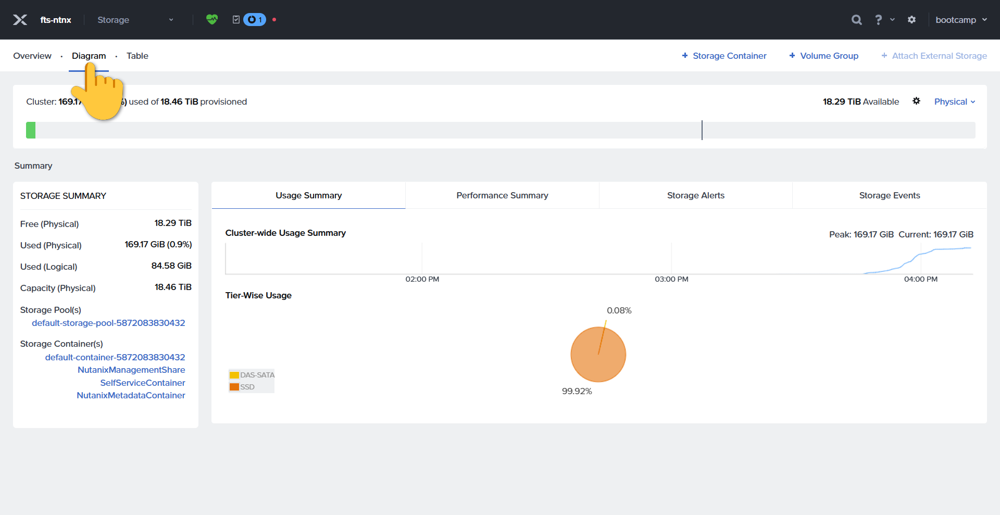
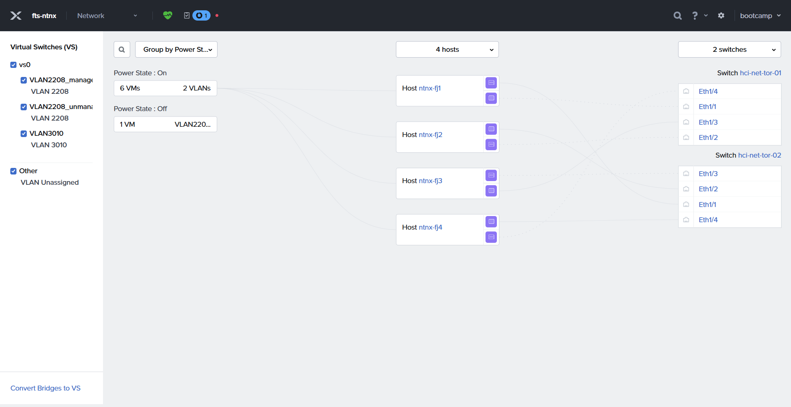
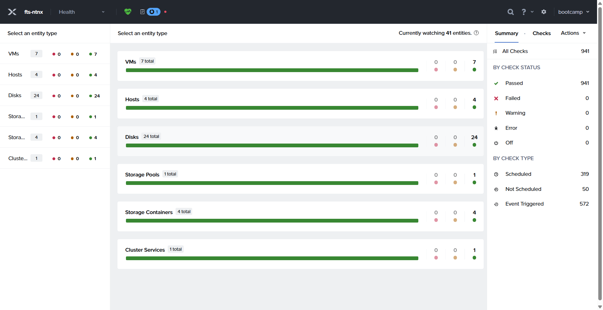

# Lab 1 – Prism Element erkunden

**Lab - Prism Element Einführung**

> This guide will teach you how to access the login page, navigate to the dashboard, and view the network diagram by visiting specific URLs and clicking on the 'Diagram' option for comprehensive network visualization.

[← Zurück zur Übersicht](../README.md)

### Schritt 1

Gehe zu https://10.3.10.200:9440/console/#login

### Schritt 2

Klicke im Dropdown auf "Hardware"

### Schritt 3

Klicke auf 'Diagram'

### Schritt 4

Wähle im Dropdown Menü "Storage"

### Schritt 5

Klicke auf 'Diagram'

### Schritt 6

Klicke im Dropdown auf 'Network'

### Schritt 7

Klicke im Dropdown auf 'Health'

