# Lab 2 – Prism Central

**Prism Central Walkthrough**

> Hier gehen wir einige wesentliche Elemente aus dem Prism Central durch.

Quelle: <https://stephopper.com/published/guide_1777396177614>

[← Zurück zur Übersicht](../README.md)

### Schritt 1

Gehe auf "Dashboard"

### Schritt 2

Das Dashboard zeigt dir unterschiedliche Metriken - es kann angepasst werden: Schiebe eines der Kästchen mittels Drag & Drop an eine andere Stelle.

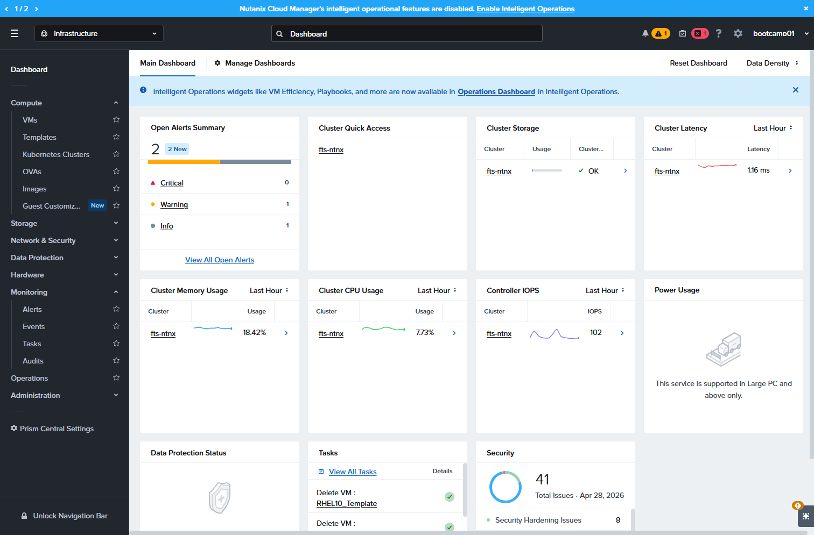

### Schritt 3

Gehe zu VMs – hier werden alle VMs angezeigt die auf allen Clustern bereitgestellt sind. Du kannst die Ansicht auf verschiedene Metriken oder Einstellungen gruppieren oder filtern.

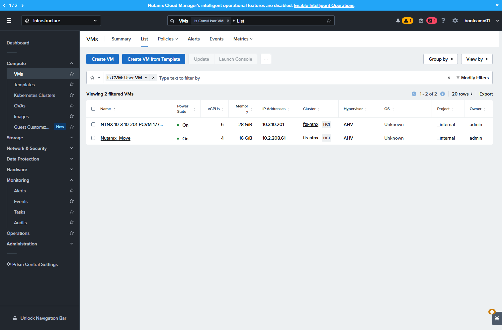

### Schritt 4

Wähle nun eine VM aus zb "Nutanix_Move"

### Schritt 5

In der VM Detail Ansicht werden sämtliche Details der VMs angezeigt.

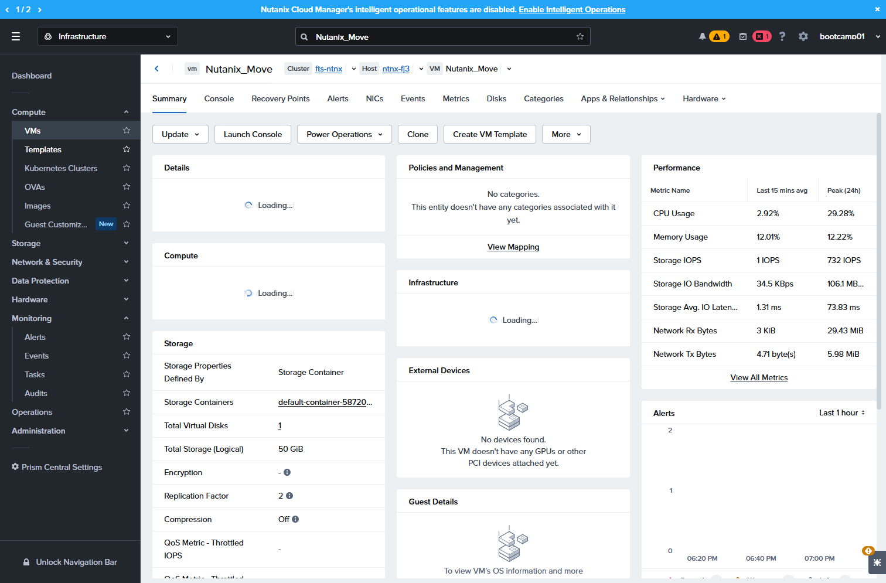

### Schritt 6

unter images können Images upgeloaded werden wie zb ISO oder Disk Images

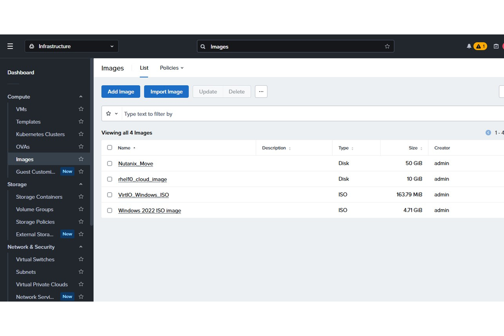

### Schritt 7

Storage Containers sind die logische Abbildung des AOS Storages im SelfService und NutanixManagementShare sind interne Container die Nutanix u.a. für das Image Service nutzt.

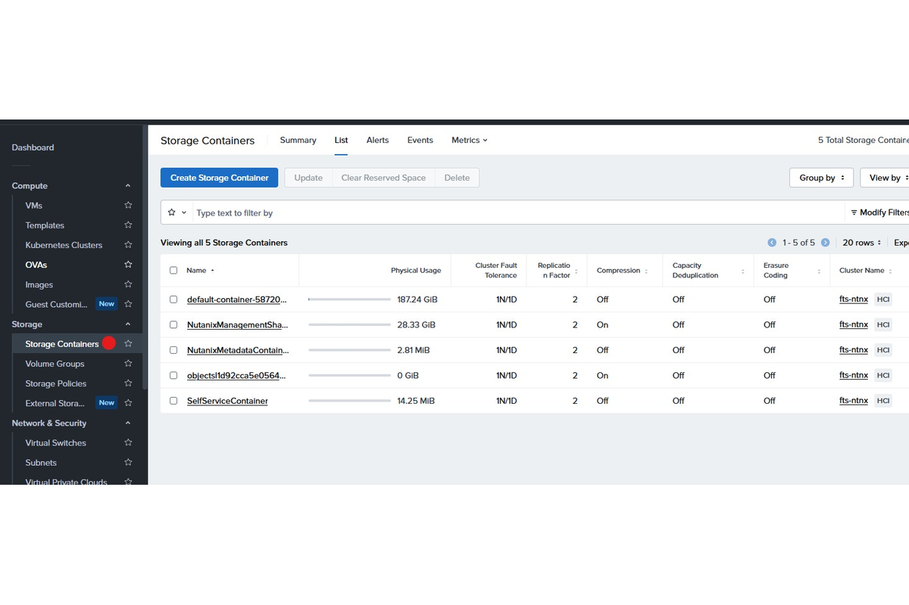

### Schritt 8

Virtual Switches bzw. ein Virtual Switch ist ein logischer verteilter Switch der sich über den ganzen Cluster streckt. Es gibt auch die Möglichkeit über mehrere Cluster einen logischen Switch zu bauen.

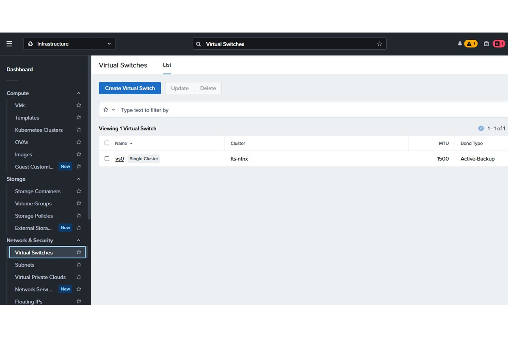

### Schritt 9

Subnet sind die logischen Netze (VLANs) wo die virtuellen Netzwerkkarten der VMs angebunden werden. Es gibt unmanaged Subnets (entspricht einer VM Port Group bei vSphere) oder Managed Subnet - diese ermöglichen ein internes IPAM zu nutzen.

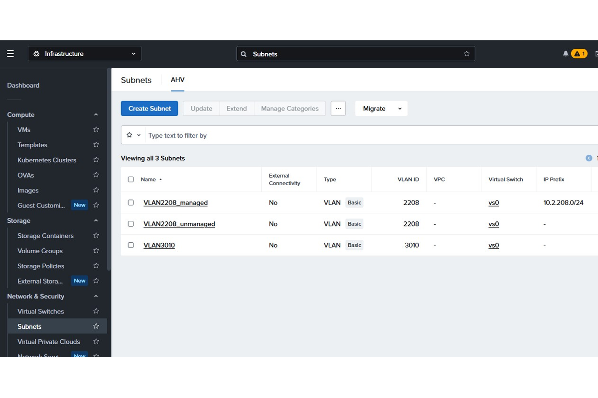

### Schritt 10

Das Security Dashboard zeigt wo bei den Nutanix Clustern noch potentielle Sicherheitslücken geschlossen werden müssen. Diese können teilweise angepasst werden an die eigenen Security Anforderungen.

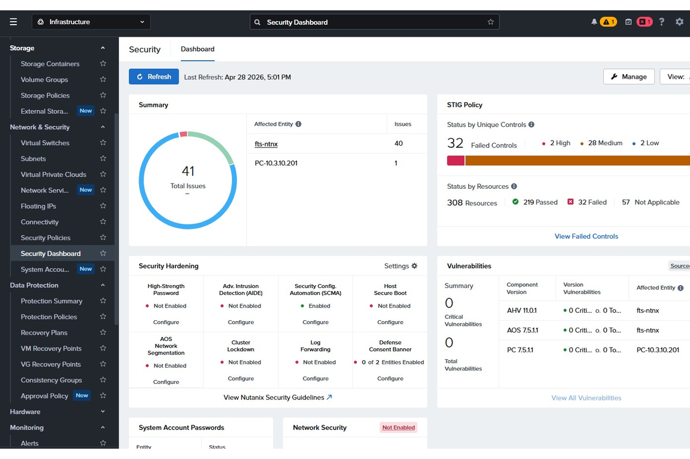

### Schritt 11

Eine der Kernfunktionen bei Nutanix ist die Möglichkeit virtuelle Maschinen auf andere Cluster zu replizieren. Dies geschieht mit den sog. "Protection Policies". Dabei werden asynchrone, semisynchrone oder synchrone Replikationen unterstützt.

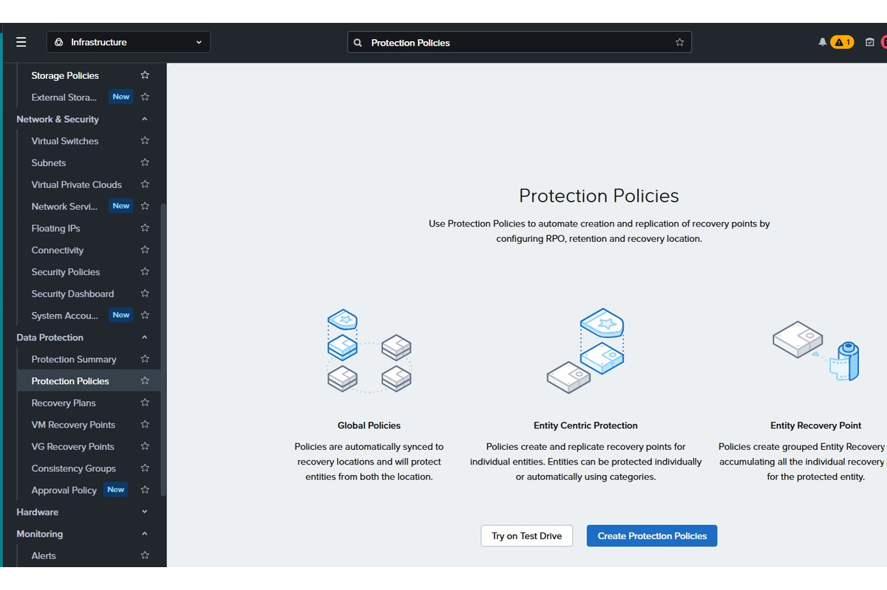

### Schritt 12

In den "Tasks" kann man die laufenden und die bereits durchgeführten Aktionen einsehen.

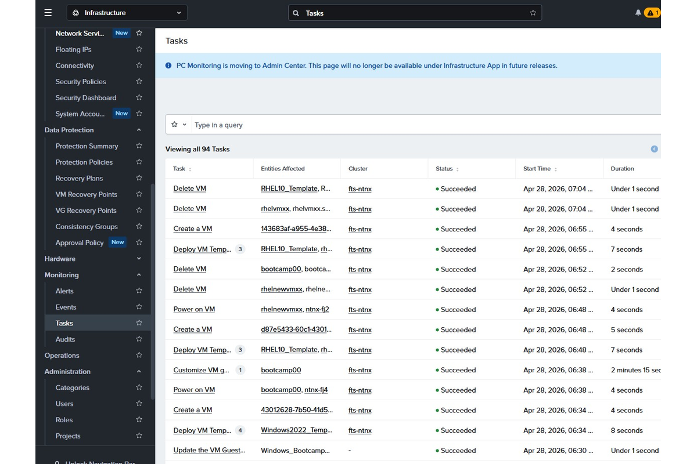

### Schritt 13

Unter "Administration" -> "IAM" kann der Zugriff zu den einzelnen Ressourcen im Nutanix Cluster gesteuert werden.

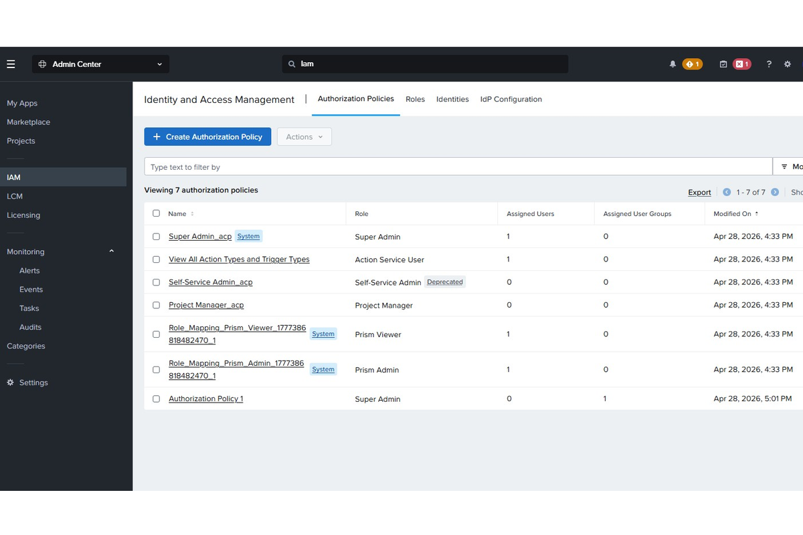

---

## Optionale Schritte

### Schritt 14

Erkunde weitere Elemente im Prism Central - Bei Unklarheiten wende dich an den Vortragenden
