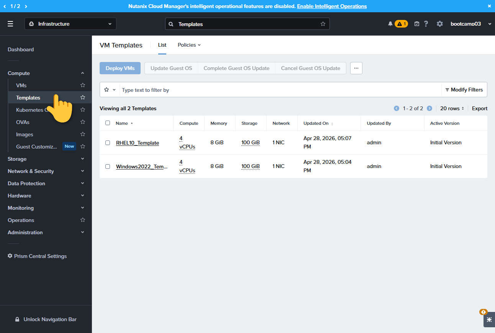
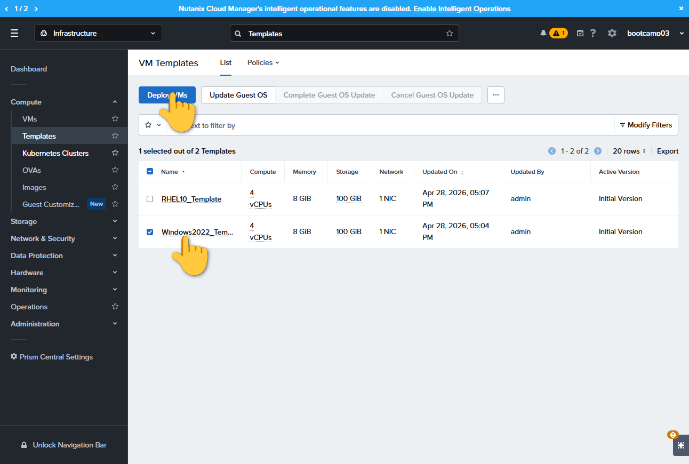
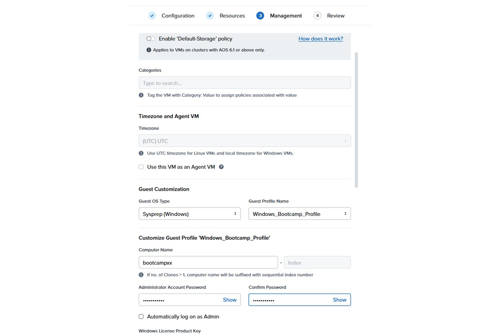
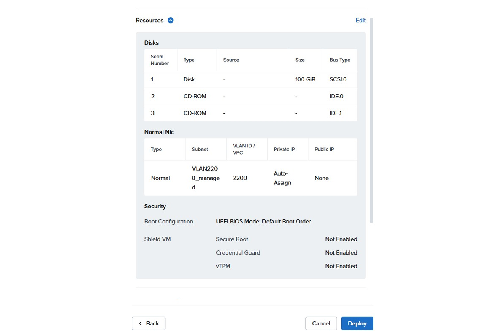

# Lab 3 – Windows VM Bereitstellung

**Windows VM Bereitstellung**

> This guide will walk you through how to access and navigate the dashboard by visiting the specified URL multiple times to ensure proper connection and review of the dashboard features.

[← Zurück zur Übersicht](../README.md)

### Schritt 1

Gehe zu Compute -> Templates

### Schritt 2

Wähle "Windows_Template" und klicke "Deploy VMs"

### Schritt 3

Klicke auf "Advanced Deploy". Vergib unter "Configuration" einen Namen für die VM (z.B. "WindowsServer" + deine zweistellige Bootcamp-Nummer) und belasse die übrigen Einstellungen. Klicke auf "Next"

### Schritt 4

Belasse unter "Resources" die Standardeinstellungen. Wähle unter "Management" bei Guest Customization den Guest OS Type "Sysprep" und Guest Profile Name "Windows_Bootcamp_Profile"; wähle "Next"

### Schritt 5

Klicke anschließend auf "Deploy"

### Schritt 6

Wähle die VM aus und starte diese mit Rechtsklick "Power Operations" --> "Power On"
