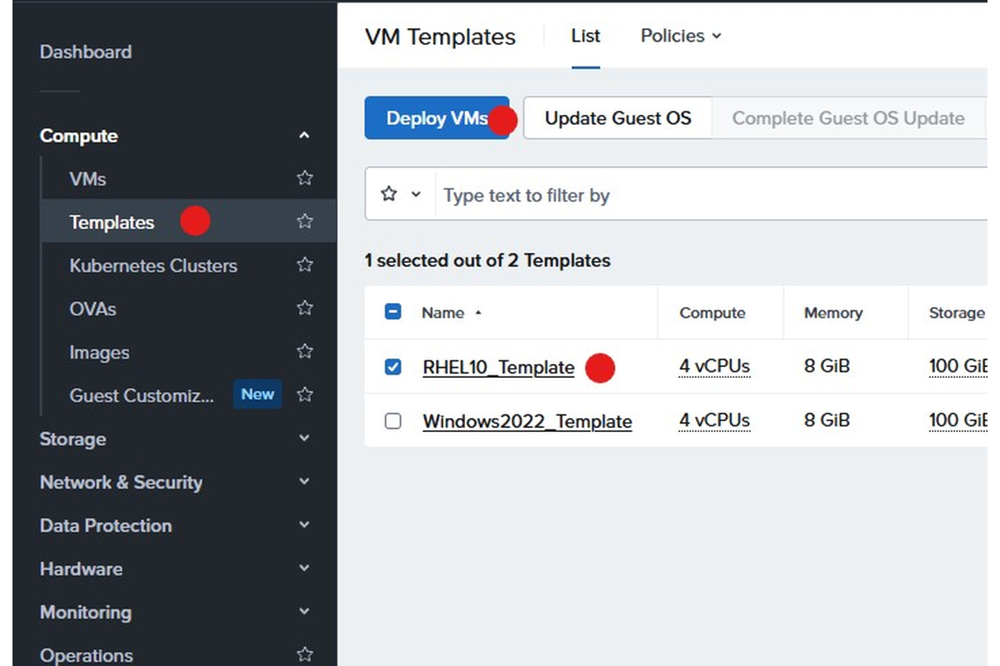
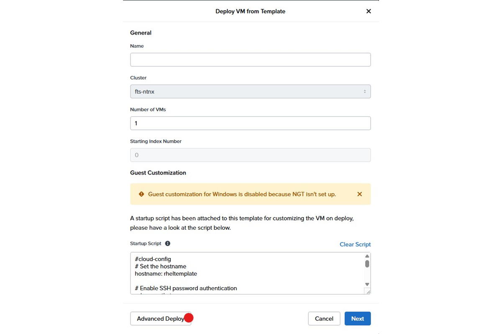
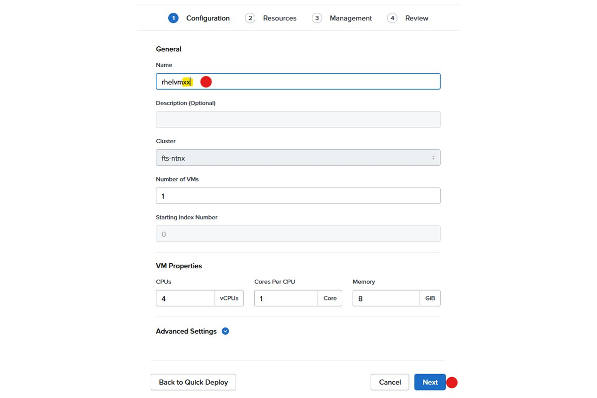
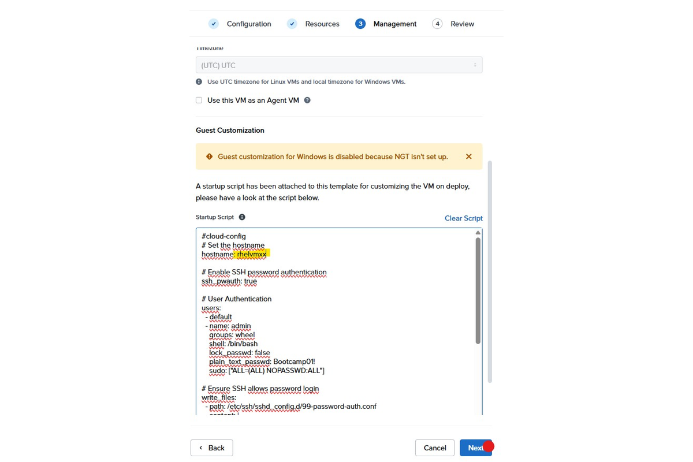
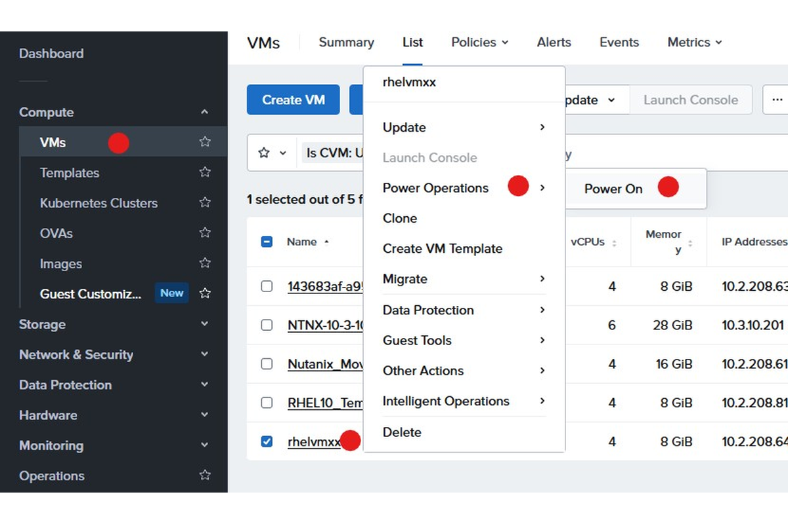
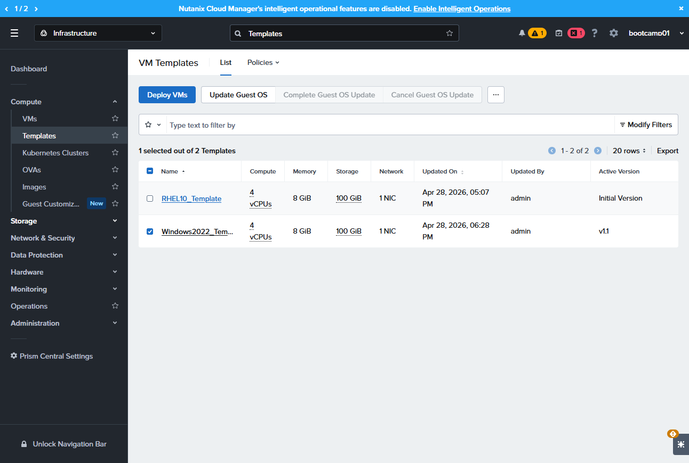

# Lab 4 – Linux VM Bereitstellung

**RHEL VM Bereitstellung**

> In diesem LAB gehen wir die Bereitstellung einer Redhat Enterprise Linux 10 VM auf Basis eines Templates und mithilfe von cloud-init durch.

Quelle: <https://stephopper.com/published/guide_1777394853027>

[← Zurück zur Übersicht](../README.md)

### Schritt 1

Gehe zu Templates, Wähle "RHEL10_Template" und klicke "Deploy VMs"

### Schritt 2

Klicke auf "Advanced Deploy"

### Schritt 3

Setze den Namen der VM und Klicke auf "Next"

### Schritt 4

unter "Ressources" belassen wir die Standardeinstellungen und klicken auf "Next"

### Schritt 5

passe den Hostnamen im cloud init Script an; ggf passe das passwort unter plain_text_password an. Klicke anschließend auf "Next"

### Schritt 6

Unter VMs suche die soeben erstelle VM heraus; wähle diese an und Klicke im Konext Menü auf "Power Operations" --> "Power On"

### Schritt 7

Navigate to https://10.3.10.201:9440/dm/infrastructure/page/vm_template

---

## Optionaler Schritt

### Schritt 8

Suche die IP Adresse der VM und versuche dich mit ssh einzuloggen
