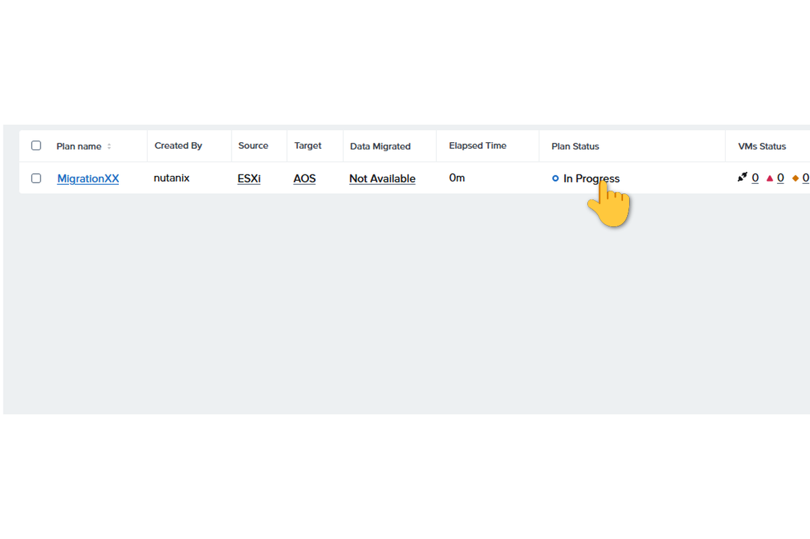
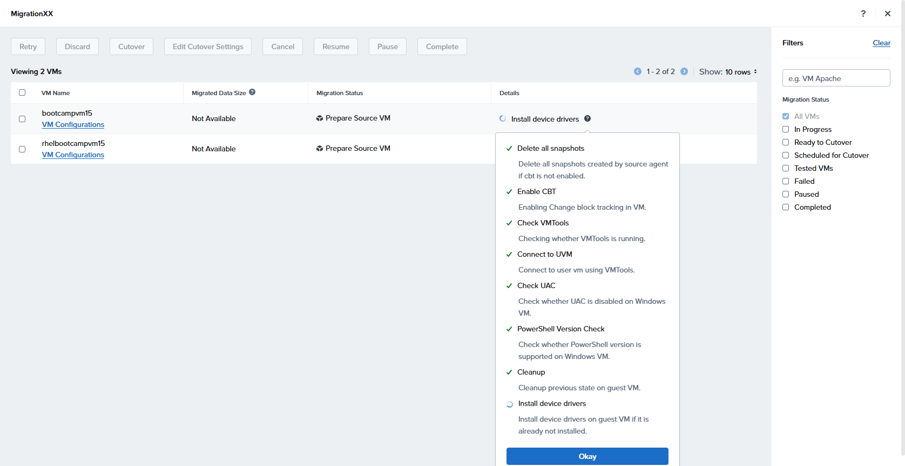

# Lab 7 – VM Migration mit Nutanix Move - Schritt 2: der Cutover

**VM Migration mit Nutanix Move Teil 2**

> This guide will walk you through how to access and manage your migration process by clicking 'In Progress', visiting the specified URL, and confirming your actions by clicking 'Okay'.

Quelle: <https://stephopper.com/published/guide_1777401425346>

[← Zurück zur Übersicht](../README.md)

### Schritt 1

Klicke bei deinem Migration Plan auf "in Progress"

### Schritt 2

Beobachte die einzelnen Schritte der VM Vorbereitung

### Schritt 3

Klicke auf "CutOver"

### Schritt 4

Warte auf die Fertigstellung; prüfe die VMs im Prism Central
